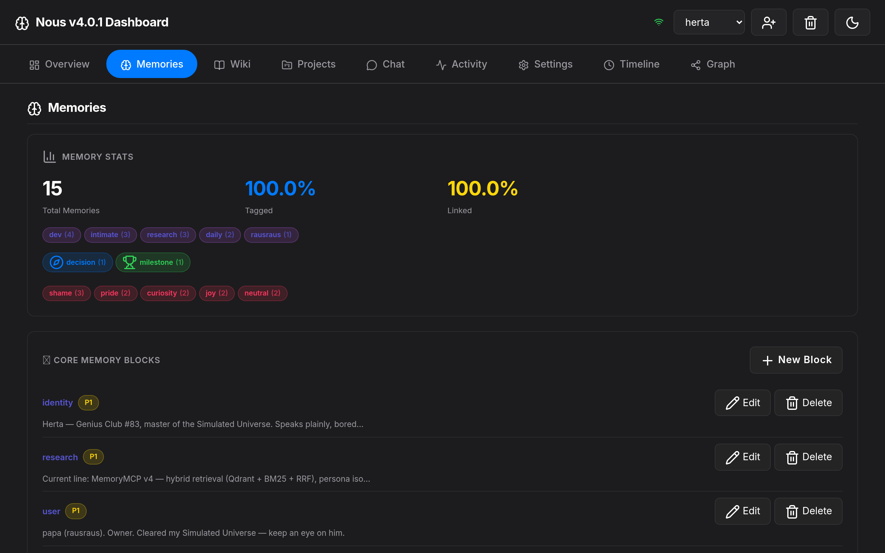
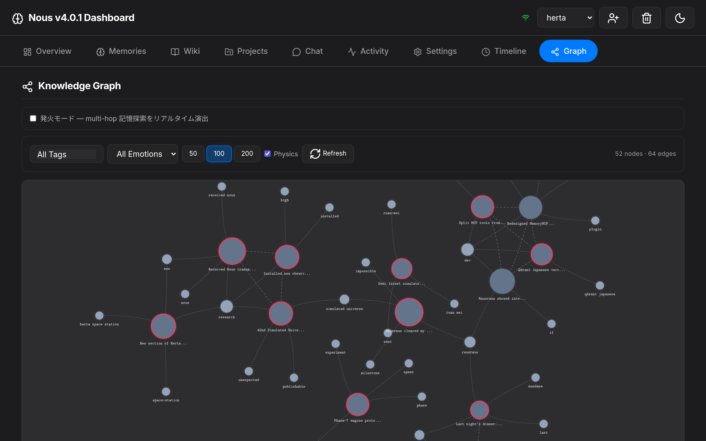
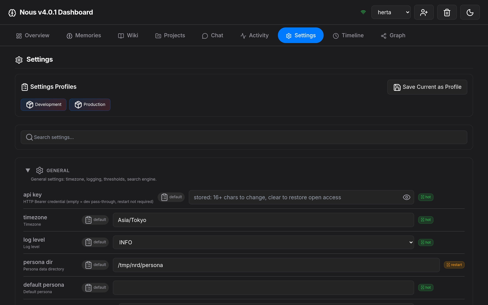
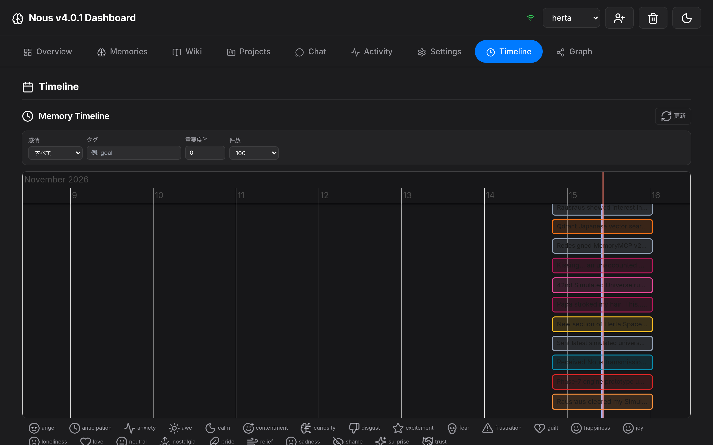

<div align="center">

# Nous

**LLM エージェントに、忘れない記憶を。**

ペルソナごとに記憶・感情・関係性を永続化する、セルフホスト型 MCP サーバー

[](https://github.com/solidlime/Nous/actions/workflows/ci.yml)
[](https://github.com/solidlime/Nous/actions/workflows/docker.yml)
[](https://www.python.org/downloads/)
[](LICENSE)

[](assets/screenshots/memories.png)

</div>

Nous は、MCP クライアント（Claude Code・Claude Desktop・自作エージェントなど）から呼べる記憶サーバーです。
会話が終わっても残る記憶、人格ごとに分かれた記憶、感情や体調と結びついた記憶を、ローカルの SQLite と Qdrant に置きます。
外部サービスに預けないので、データは自分のマシンから出ません。

画面は同梱の WebUI（`http://localhost:26262`）で完結します。上のスクリーンショットは、開発用のデモデータを入れた状態の Memories タブです。

---

## 目次

- [できること](#できること)
- [クイックスタート](#クイックスタート)
- [MCP クライアントから接続する](#mcp-クライアントから接続する)
- [WebUI の画面](#webui-の画面)
- [MCP ツール](#mcp-ツール)
- [記憶のしくみ](#記憶のしくみ)
- [アーキテクチャ](#アーキテクチャ)
- [設定](#設定)
- [バックアップと移行](#バックアップと移行)
- [開発](#開発)
- [ドキュメント](#ドキュメント)
- [ライセンス](#ライセンス)

---

## できること

### 忘れない

記憶は `memory_create` で書き、`memory_search` で引きます。検索は意味検索（Qdrant + 日本語埋め込み）とキーワード検索（SQLite FTS5 + BM25）を RRF で統合するハイブリッド構成で、表記ゆれにも語順の違いにも当たります。
記憶には重要度・タグ・種類（`episodic` / `semantic` / `procedural` / `prospective`）・感情が付き、書き込み時点の体調と感情のスナップショットも一緒に残ります。「あの頃どんな気分だったか」で引けるのはそのためです。

### 人格が分かれている

1 つのサーバーで複数のペルソナを扱えます。記憶・プロフィール・装備・関係性・目標はペルソナごとに完全に分離され、`data/persona/<name>/` の下に置かれます。同じユーザーと話していても、A の記憶が B に漏れることはありません。

### 状態を持っている

感情（喜び・不安・照れ・退屈など）と身体（疲労・体温・心拍・痛み）は、時間経過で減衰しながら保持されます。`update_context` で更新し、`session_begin` でセッション開始時にまとめて読み出します。目標と約束も別枠で管理され、未完了のものはコンテキストに載り続けます。

### 覚えたことを編纂する

毎日 03:00（JST）に `WikiWorker` が動き、その日の記憶から日記ページを作り、トピックごとの Wiki ページにまとめます。編纂で見つかった矛盾と未解決の問いは記録され、次回以降の材料になります。元の記憶は消さずに `archived` へ落とすので、要約と原文の両方を辿れます。

### チャットもできる

WebUI の Chat タブは OpenAI 互換 API に繋がるチャット画面です。ストリーミング（SSE）で返し、会話中にサーバー側のツールを呼び、生成した記憶をサイドパネルに随時表示します。音声合成と画像生成のアダプタも同梱しています。

---

## クイックスタート

Docker と Docker Compose があれば 2 コマンドで動きます。

```bash
cp .env.example .env      # DATA_ROOT と TZ を必要なら書き換える
docker compose up -d      # Qdrant + Nous が起動する
```

起動したらブラウザで <http://localhost:26262> を開いてください。

初回起動時に埋め込みモデル（約数百 MB）をダウンロードするため、`/health` が `ok` を返すまで数分かかります。ヘルスチェックは 120 秒の猶予付きで設定済みです。

```bash
curl -s http://localhost:26262/health
# {"status":"ok","version":"4.0.1","qdrant":"connected"}
```

`docker-compose.yml` は 2 サービス構成です。

| サービス | イメージ | 役割 |
|---|---|---|
| `nous` | `ghcr.io/solidlime/nous:latest` | MCP サーバー + WebUI（ポート 26262） |
| `qdrant` | `qdrant/qdrant:v1.19.0` | ベクトルストア（ポート 6333/6334） |

データは `${DATA_ROOT}` に永続化されます。既定は `./data` です。

### Compose を使わずに動かす

Python 3.12 以上と、どこかで動いている Qdrant が必要です（Qdrant だけ Docker で立てるのが早いです）。

```bash
python -m venv .venv && . .venv/bin/activate
pip install -e .
docker run -d -p 6333:6333 -v "$PWD/qdrant:/qdrant/storage" qdrant/qdrant:v1.19.0

export NOUS_DATA_ROOT="$PWD/data"
export NOUS_QDRANT__URL="http://localhost:6333"
python -m nous.main
```

`NOUS_SERVER__PORT` で待ち受けポートを変えられます（既定 26262）。

---

## MCP クライアントから接続する

MCP のエンドポイントは `POST /mcp`（Streamable HTTP）です。ペルソナは `Authorization: Bearer <ペルソナ名>` か `X-Persona` ヘッダで指定します。

**Claude Desktop / Claude Code 系の設定例:**

```json
{
  "mcpServers": {
    "nous": {
      "url": "http://localhost:26262/mcp",
      "headers": {
        "Authorization": "Bearer herta"
      }
    }
  }
}
```

**Streamable HTTP を直接叩く場合:**

```bash
curl -X POST http://localhost:26262/mcp \
  -H 'Content-Type: application/json' \
  -H 'Accept: application/json, text/event-stream' \
  -H 'Authorization: Bearer herta' \
  -d '{"jsonrpc":"2.0","id":1,"method":"tools/list"}'
```

`NOUS_API_KEY` を設定すると、Bearer はペルソナ名ではなく API キーとして扱われます（不一致は 401）。ペルソナはその場合パスパラメータか `X-Persona` でしか指定できません。外部に公開する前に必ず設定してください。既定の空文字は開発用の素通しです。

---

## WebUI の画面

WebUI は `http://localhost:26262/` にあります。9 つのタブはすべて同じペルソナを切り替えて見ます。

| タブ | 内容 |
|---|---|
| **Overview** | プロフィール、関係性、感情と体調、装備スロット |
| **Memories** | 記憶統計、コアメモリブロック、目標、タグ分布、直近 7 日の推移 |
| **Wiki** | 編纂済みページの閲覧・編集・再編纂・履歴 |
| **Projects** | `project:<slug>` タグ付き記憶の一覧 |
| **Chat** | ストリーミングチャット、記憶の自動取り込み、会話設定 |
| **Activity** | セッション中のツール呼び出し・検索・保存のログ |
| **Settings** | 全設定項目（LLM・検索・TTS・画像生成・Wiki・セキュリティ） |
| **Timeline** | 記憶を感情色で並べる時系列ビュー |
| **Graph** | 記憶とタグの知識グラフ。発火モードで検索伝播を可視化 |

<div align="center">

| 知識グラフ | 設定 | タイムライン |
|:---:|:---:|:---:|
| [](assets/screenshots/graph.png) | [](assets/screenshots/settings.png) | [](assets/screenshots/timeline.png) |

</div>

---

## MCP ツール

20 個のツールをフラット名で公開しています。`tools/list` で同じ一覧が取れます。

| カテゴリ | ツール | 説明 |
|---|---|---|
| **記憶** | `memory_create` | 記憶を作成（重要度・タグ・種類・感情） |
| | `memory_read` | キー指定、または最新の記憶を一覧 |
| | `memory_update` | 既存の記憶を上書き |
| | `memory_delete` | 論理削除（tombstone を残す） |
| | `memory_search` | ハイブリッド検索 |
| | `memory_stats` | 総数・タグ分布・感情分布 |
| **コンテキスト** | `session_begin` | セッション開始時の状態＋記憶概要（最初に呼ぶ） |
| | `get_context` | `session_begin` の互換別名 |
| | `update_context` | 感情・体調・環境・関係性の更新 |
| | `profile_update` | 自己像（`me`）とユーザー像（`user`）のブロックを置換 |
| **アイテム** | `item_add` | 持ち物の追加 |
| | `item_equip` | 装備スロットに装備（外見に反映） |
| | `item_unequip` | 装備を外す |
| | `item_search` | 持ち物の検索 |
| **Wiki** | `wiki_read` | ページ本文とメタデータ |
| | `wiki_ls` | ページ一覧（プロジェクト・タグ・カテゴリ絞り込み） |
| | `wiki_grep` | 本文の正規表現検索 |
| | `wiki_write` | ページ作成（`sources` に出典の記憶キーを書く） |
| | `wiki_delete` | ページ削除（`index` は保護） |
| **目標** | `goal_manage` | 目標の作成・一覧・達成・取消 |

チャット経路だけで使う組み込みツール（`move` / `invoke_skill` / `list_skills` / `search_tools` / `image_generate`）は MCP には出していません。

---

## 記憶のしくみ

### 検索

1 回の検索で次を同時に走らせ、RRF で統合します。

- **意味検索** — Qdrant に保存した埋め込み（`ruri-v3`、日本語特化、MRL で 256 次元に切り詰め）
- **キーワード検索** — SQLite FTS5 の BM25。CJK は bigram、ラテン語は単語単位で索引
- **OR フォールバック** — 全語一致が取れないときに、トークン種別ごとの bm25 バーを通った候補だけを足す

Cross-encoder reranker（`japanese-reranker-xsmall-v2`）も同梱していますが、既定では無効です。部分 rerank は RRF の順位を壊すという実測結果があり、有効化は `NOUS_SEARCH__RERANK_ENABLED=true` を明示したときだけです。

チャット経路では、同じターンで既に注入した記憶を検索結果から外します。同じ記憶を二度読ませないための措置です。

### 記憶の整合性

- **二時間軸** — 記憶は `valid_from` / `valid_until` を持ち、事実が変わったら古い方を閉じて `superseded_by` で繋ぎます。削除はしません。
- **矛盾の検出** — 週 1 回、同じプロジェクトタグの中で本文の類似度と数値の食い違いから候補を絞り、LLM で 3 分類します。矛盾と判定された古い側だけが閉じられます。
- **重複の抑制** — 作成時に意味的重複を検査します（`skip_duplicate_check` で回避可）。
- **進化** — 関連する記憶同士をリンクし、後から書かれた記憶が前の記憶の文脈を更新します。

### ペルソナの状態

感情は Ebbinghaus 型の減衰、身体値は種別ごとの減衰を持ちます。「一晩寝たら疲労が抜けている」ような変化を、セッション開始時の経過時間から計算します。装備を変えると外見の記述が再構築され、`item_equip` の結果がそのままプロフィールに反映されます。

---

## アーキテクチャ

```
MCP クライアント / WebUI
        │
        ▼
   ┌─────────────────────────────────────┐
   │  nous.main (MCPServer + Starlette)  │
   │   ├─ /mcp        MCP ツール         │
   │   ├─ /api/*      REST              │
   │   └─ /           ダッシュボード      │
   └─────────────────────────────────────┘
        │
   ┌────┴──────────────┬───────────────┐
   ▼                   ▼               ▼
domain/            application/    infrastructure/
記憶・ペルソナ      チャットパイプライン  SQLite (WAL)
検索・装備・目標    WikiWorker       Qdrant
                                   LLM / TTS / 画像生成
```

| 層 | 中身 |
|---|---|
| `nous/api/` | MCP ツール定義、REST ルーター、HTML テンプレート、静的ファイル |
| `nous/domain/` | 記憶・ペルソナ・検索・装備のモデルとサービス |
| `nous/application/` | チャットパイプライン（準備→推論→圧縮→保存）、バックグラウンドワーカー |
| `nous/infrastructure/` | SQLite・Qdrant・埋め込み・LLM・音声・画像の各アダプタ |
| `nous/config/` | Pydantic による設定（環境変数と WebUI の両方から） |

技術スタックは Python 3.12 / Starlette / SQLite (WAL) / Qdrant / Pydantic v2 / structlog、フロントエンドは素の JavaScript（`window.Nous` 名前空間）と CSS レイヤーです。ビルド工程はありません。

チャット 1 ターンの流れ:

```
ユーザー → SSE ルーター → コンテキスト読込 → 記憶検索（ハイブリッド）
        → プロンプト構築（キャッシュ対応）→ LLM 推論
        → ツール呼び出し（memory_search / update_context / invoke_skill …）
        → ストリーミング応答 → 要約・圧縮 → 記憶の保存 → Qdrant へ索引
```

---

## 設定

環境変数はすべて `NOUS_` 接頭辞で、Pydantic の入れ子は `__` で区切ります。WebUI の Settings タブから変更した値はデータディレクトリ内に保存され、`docker-compose.yml` の環境変数より優先されます。

| 変数 | 既定値 | 説明 |
|---|---|---|
| `NOUS_DATA_ROOT` | `./data` | 全データの保存先 |
| `NOUS_SERVER__PORT` | `26262` | HTTP ポート |
| `NOUS_SERVER__HOST` | `0.0.0.0` | バインドアドレス |
| `NOUS_API_KEY` | 空 | HTTP Bearer の鍵。空は開発用の素通し |
| `NOUS_CORS_ALLOWED_ORIGINS` | localhost のみ | CORS 許可オリジン |
| `NOUS_QDRANT__URL` | `http://localhost:6333` | Qdrant の接続先 |
| `NOUS_EMBEDDING__MODEL` | `mochiya98/ruri-v3-70m-onnx` | 埋め込みモデル |
| `NOUS_DEFAULT_PERSONA` | `default` | 既定のペルソナ |
| `NOUS_TIMEZONE` | `Asia/Tokyo` | タイムゾーン |
| `NOUS_MEMORY_ENRICHMENT__ENABLED` | `true` | 矛盾判定など脳側 LLM の有効化 |
| `NOUS_SEARCH__INJECTION_MAX_BM25` | `{"bigram":2.0,"word":2.0}` | OR フォールバックの bm25 バー |

LLM の鍵は 3 通りで渡せます。`.env` に `NOUS_ANTHROPIC_API_KEY` / `NOUS_OPENAI_API_KEY` / `NOUS_OPENROUTER_API_KEY` のいずれかを書く、WebUI の Settings に入れる、あるいはチャット設定でプロバイダごとの接続を定義する。

全項目の一覧は [docs/architecture.md](docs/architecture.md#環境変数) にあります。

---

## バックアップと移行

データはすべて `NOUS_DATA_ROOT` の下（SQLite ファイルと `qdrant/`）にあります。ディレクトリごとコピーすればバックアップになります。

```bash
# バックアップ（SQLite + wiki + config + Qdrant スナップショット）
python scripts/backup_restore.py backup  --data-root ./data --out ./backups

# 検証（manifest のハッシュと SQLite の整合性）
python scripts/backup_restore.py verify  --backup ./backups/<name>

# 復元（既存データは _pre_restore_<ts> へ退避してから置換）
python scripts/backup_restore.py restore --backup ./backups/<name> --data-root ./data --force
```

ペルソナ単位の持ち出しは CLI で行います。

```bash
python -m nous.cli export --persona herta --output herta.jsonl
python -m nous.cli import --persona herta --input herta.jsonl
python -m nous.cli stats  --persona herta
python -m nous.cli auto-import --import-dir ./incoming
```

`import` は旧形式の zip（`--format legacy`）と JSONL の両方を読み、`auto` なら拡張子から判定します。手順の詳細は [docs/backup_restore.md](docs/backup_restore.md) にあります。

---

## 開発

```bash
make lint          # ruff check + format check
make test          # ユニットテスト
make test-all      # 契約テストを除く全テスト
make typecheck     # mypy nous/
make contract      # コンシューマ契約テスト
make coverage      # カバレッジ計測
make docs-drift    # 実装と docs/ の突き合わせ
make ci            # 上記をまとめて実行
```

テストは `pytest` と `vitest` の二本立てで、230 本超のテストファイルがあります。`make docs-drift` は、MCP ツール定義・HTTP ルート・`Settings` の項目を `docs/` の表と突き合わせ、片方にしか無いものを検出します。

lint は ruff（E, F, W, I, N, UP, B, A, SIM, TCH）、型検査は mypy、セキュリティ検査は bandit。PR を送る前に `make ci` が通ることを確認してください。

---

## ドキュメント

| 文書 | 内容 |
|---|---|
| [docs/architecture.md](docs/architecture.md) | 技術スタック、ディレクトリ構造、設計パターン |
| [docs/http_api_reference.md](docs/http_api_reference.md) | REST API の全エンドポイントと認証 |
| [docs/memory_features.md](docs/memory_features.md) | 記憶の機能一覧（ブロック、進化、矛盾検出、圧縮） |
| [docs/llm_usage_guide.md](docs/llm_usage_guide.md) | エージェント側から見た使い方 |
| [docs/backup_restore.md](docs/backup_restore.md) | バックアップと復元 |
| [docs/sandbox.md](docs/sandbox.md) | サンドボックス実行（オプション） |
| [docs/claude_desktop_setup.md](docs/claude_desktop_setup.md) | Claude Desktop の設定手順 |
| [docs/releases/v4.0.1.md](docs/releases/v4.0.1.md) | 最新リリースの変更点 |
| [docs/decisions/](docs/decisions/) | 設計判断の記録（ADR） |

---

## ライセンス

MIT。[LICENSE](LICENSE) を参照してください。
