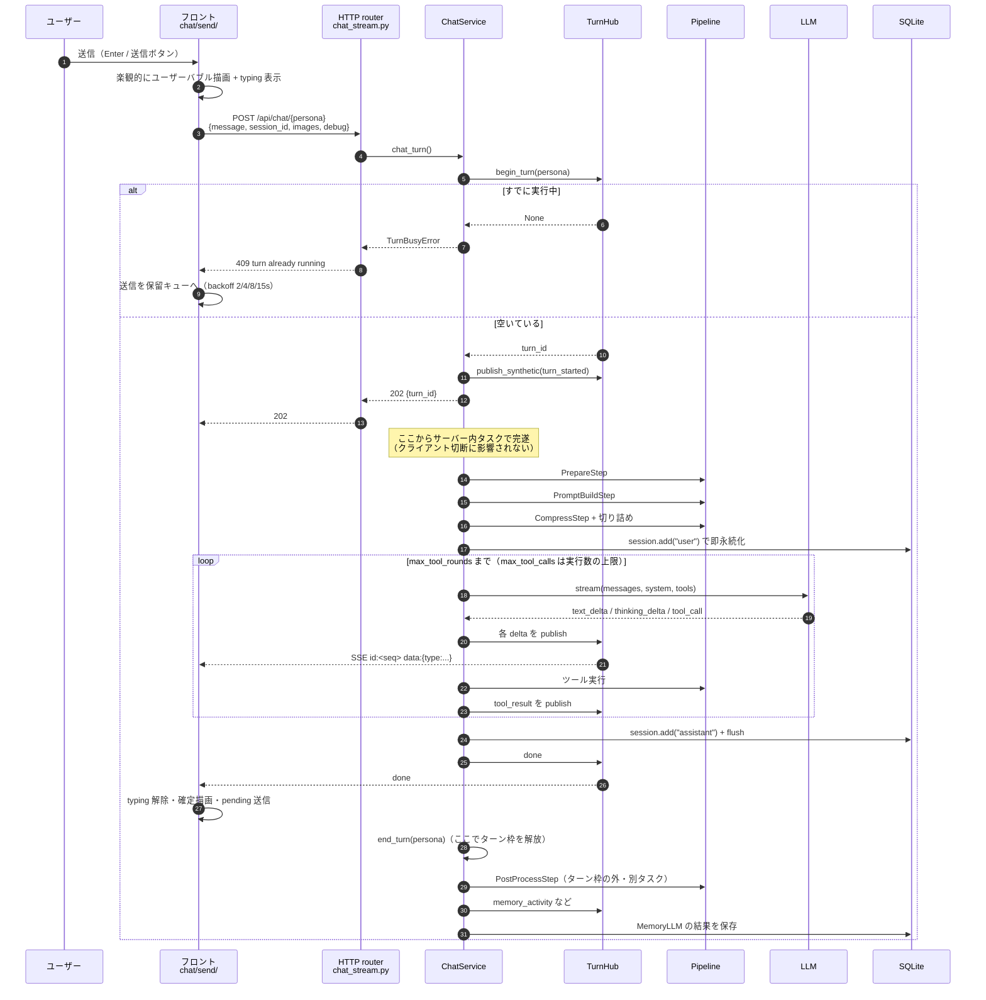

# チャットの動作フロー

1 ターンの会話が「フロントの送信」から「記憶の保存」までどう流れるかの全体像。
コードを読むときの地図として使う。各段の根拠ファイルは末尾の対応表にまとめた。

対象は HTTP 経由のキャラチャット（WebUI / API クライアント）。CLI は別経路。

---

## 0. 登場人物（レイヤ）

| 層 | 実体 | 役割 |
| --- | --- | --- |
| フロント | `nous/api/http/static/chat/` | 送信・楽観描画・SSE 受信・再同期 |
| HTTP | `nous/api/http/routers/chat/` | 受付、設定 CRUD、添付、SSE 購読 |
| ターン管理 | `ChatService` + `TurnHub` | persona ごと 1 ターンの排他、配信 |
| パイプライン | `nous/application/chat/pipeline/` | 準備 → プロンプト → 推論 → 修復 → 後処理 |
| 推論 | `nous/infrastructure/llm/` | プロバイダ抽象、ツール記法の復旧 |
| ツール | `nous/application/chat/tools/` + MCP pool | builtin / MCP / workspace |
| 永続化 | SQLite (`chat_sessions`, `session_events`, `memories` …) | 会話・記憶・状態 |

**設計の要**: チャットの本文 delta は EventBus を通さない。`TurnHub` 専用のリングバッファに流れ、
`GET /api/chat/{persona}/events` を購読している全クライアントへ配られる。
EventBus は低頻度イベント（記憶の保存通知など）用。この分離が E3「チャット分離」の芯。

---

## 1. 全体シーケンス



---

## 2. 送信 — フロント側

`nous/api/http/static/chat/send/pending.js` の `chatSend()` → `_attemptSend()`。

1. 入力値と `CHAT.attachments` を payload にまとめる。添付は先に
   `POST /api/chat/{persona}/attachment/upload` へ上げ、返ったパスをメッセージ本文に足す。
   画像は `images[]`（base64）として別枠で送る。
2. **楽観描画**: ユーザーバブルを即座に出す。サーバー応答は待たない。
3. `beginTurnSession()` で描画セッションを開き、`POST` する。
4. 応答で分岐:
   - `202` → 保留解除。あとは SSE を待つだけ。
   - `409` → サーバーはまだ前のターンを処理中。**ユーザーバブルを消して入力を戻し**、
     保留キューに積む（1 スロット・最新優先、`PENDING_BACKOFF = [2000, 4000, 8000, 15000]`、
     上限 `PENDING_MAX = 10`）。次の `done`/`error` で自動再送。
   - その他 → トーストで 1 回だけ知らせ、入力を戻す。

再接続用に `_chatLastSeq` を持つ。SSE の `id:` を覚えておき、切断後の URL に
`?last_seq=N` を付けて開き直すと、取りこぼした分だけが replay される。

### キャンセル

`chatCancel()` は**ローカル描画を止めるだけ**。サーバーに中断 API は無く、ターンは最後まで走る。
`done` が来たら履歴を取り直して同期する（`_syncAfterForeignDone`）。この非対称は既知の仕様。

---

## 3. 受付 — `POST /api/chat/{persona}`

`nous/api/http/routers/chat/chat_stream.py::chat_endpoint`。

| 条件 | 応答 |
| --- | --- |
| persona 不在 | `404 {"detail": "Persona not found"}` |
| JSON 不正 | `400 {"detail": "Invalid JSON"}` |
| 本文が空（画像も無し） | `400`（空メッセージ拒否） |
| 同じ persona がターン実行中 | `409 {"detail": "turn already running"}` |
| 受付成功 | `202 {"turn_id": "..."}` |

受付後は**サーバー内タスク**（`_spawn_turn`）でパイプラインを回す。HTTP リクエストは即座に切れる。
だからクライアントが落ちてもターンは完遂され、履歴も残る。

`ChatConfig` は `ChatConfigFileRepository` から毎ターン読み直す（`data_root` 配下の設定ファイル）。
設定変更は次ターンから効く。

---

## 4. 配信 — `GET /api/chat/{persona}/events?last_seq=N`

`nous/application/chat/turn_hub.py` + `chat_event_stream`。

- `TurnHub` は persona ごとに:
  - リングバッファ **600 件**（`buffer_size`）に `(seq, sse文字列)` を保持
  - 購読者ごとの `asyncio.Queue` **256 件**（`queue_size`、あふれたら drop-oldest）
  - `_seqs[persona]` で単調増加の seq を振る
  - `_running` で「同時 1 ターン」を保証
- ストリームは 3 段:
  1. `snapshot_after(last_seq)` を `id: <seq>` 付きで replay
  2. ライブ push（`seq <= last` は捨てる。subscribe と snapshot の競合対策）
  3. 15 秒無通信なら `: keepalive`
- ワーカースレッドから publish されたときは `call_soon_threadsafe` で配る
  （内省などスレッド由来のイベントを取りこぼさないため）。

フロントは接続した瞬間に**バックログ全量**を受け取る。これを live と誤認すると
過去の `tool_call` を再実行表示してしまうので、アイドル時は `_hubSkipMode` で
最初の `done`/`error` まで飲み込む。ターン進行中の再接続ではスキップしない
（replay こそが欠けた尻尾だから）。

---

## 5. パイプライン

`ChatService.chat()` が順に呼ぶ。`ChatTurnContext` が段をまたぐ状態コンテナ。

### 5.1 即時ハートビート

```python
yield ": heartbeat\n\n"
```

準備段が重い間、フロントのストリーム読み取りがタイムアウトしないようにする。
**記憶の検索は `PrepareStep` の 1 回だけ**。以前は service 側が速報（`preliminary=True`）を
流していたが、検索が 2 回走って準備段を遅くしていたので廃止した（`MemoryActivitySSE.preliminary`
フィールド自体は互換のため残るが、`ChatService` は常に `False` で流す）。

### 5.2 `PrepareStep` — 文脈の組み立て

`nous/application/chat/pipeline/prepare.py`。

1. **前ターンの MemoryLLM を待つ**（`session.pending_memory_task`）。記憶の書き込みが
   次ターンの検索に間に合うようにするための同期点。
2. **状態の減衰を適用**:
   - `_apply_emotion_decay` — 感情強度の自然減衰
   - `_apply_body_decay` — 体調・体力
   - `_apply_circadian_drift` — 時間帯 × 会話の空白で居場所を移す
   - `_apply_relationship_decay` — 関係性
3. `turn_ctx.state_raw` / `turn_ctx.time_context` を確定。
4. **並行実行**（`asyncio.gather`）:
   - `_build_context_section` — 状態・関係・時間帯・decay note を 1 ブロックに
   - `_search_memories` — ハイブリッド検索（ベクトル＋キーワード＋RRF）。
     クエリは直近ユーザー発言 3 件の結合（`_build_recall_query`、800 字上限、新しい方優先）
   - 片方が落ちても例外は握って空で続行（会話は止めない）
5. `_build_digest` で recency digest（直近記憶の要約、`memory_digest_count` 件）。
6. 記憶が薄いときは Episode Memory にフォールバック（HiMem 2-tier）。

`memory_preload_count`（既定 5）だけ先に注入し、足りない分は LLM 自身が
`memory_search` ツールで引く（progressive disclosure）。

### 5.3 `PromptBuildStep` — system プロンプト

`nous/application/chat/pipeline/prompt.py`。

- ペルソナ定義 + 現在状態 + 記憶 + スキル + 時間文脈を組み立てる
- **プレフィックスキャッシュを壊さない順序**で並べる（変わらないものを先、毎ターン変わるものを後）
- `skills_raw` に注入したスキルを記録（PostStep のデバッグ用）

### 5.4 感情由来の温度

`config.dynamic_temperature` が有効なら `EmotionDrivenSampler.compute()` で
基準温度を感情・強度で補正する。`emotion_intensity` は境界で正規化
（欠損・非数値・範囲外は 0.5）。

### 5.5 `CompressStep`＋切り詰め

`compress.py` / `trimmer.py`。

- トークン予算超過、または `max_stored_messages` 超過で圧縮
- **LLM メッセージで数える**（`tool` メッセージも 1 件）
- スライス先頭が `tool` になる場合は `_adjust_slice_start` で広げる。
  孤立した `tool` メッセージはプロバイダが 400 を返すため
- 落とした区間は `_build_truncation_highlights` で要約化し、履歴要約として注入
- 実際に圧縮したら `ContextCompressedSSE` を流す（フロントが「圧縮した」と表示できる）

### 5.6 `InferenceStep` — ストリームとツールループ

`nous/application/chat/pipeline/inference.py`。ここが本丸。

```python
while True:
    if _rounds >= max_rounds:   # max_tool_rounds（既定 10）
        break
    visible_tools = registry.get_visible_tools() if _tools_enabled else []
    async for event in provider.stream(...):
        ...
```

- **ラウンド上限**は `max_tool_rounds`（既定 10）。`max_tool_calls` とは別で、
  「実行できるツール呼び出しの総数」と「推論→実行の往復回数」を分けて縛る。
  上限に当たったら締めの一言を要求する（`_TOOL_ROUNDS_MESSAGE`）。
- ツール無効（`max_tool_calls == 0`）のターンは 1 ラウンドで抜ける。

- **ツール宣言は予算切れでも続ける**（`_tools_enabled = config.max_tool_calls > 0`）。
  宣言を止めるとモデルはツール呼び出しを独自記法（DeepSeek の DSML 等）で本文に
  吐き出し、実行されないまま発言として保存される。実行だけを予算で止める。
- ストリームイベントの対応:

| プロバイダ側 | SSE | `turn_ctx` への反映 |
| --- | --- | --- |
| `TextDeltaEvent` | `text_delta` | `full_response` に追記、`segments` に text |
| `ThinkingDeltaEvent` | `thinking_delta` | **別バッファ**（TTS にも本文にも混ぜない） |
| `ToolCallEvent` | `tool_call` | 重複 ID を除外して `pending_tool_calls` へ |
| `ErrorEvent` | `error` | 即 return |
| `DoneEvent` | — | `finish_reason` / `usage` を記録 |

- `finish_reason == "length"` なら最大 **3 回**まで自動継続
  （部分テキストを assistant、`（つづき）` を user に置いて再ストリーム。空 user は 400 になるため非空）
- ツール実行:
  - `image_generate` は実行前に `ImageGenStartSSE` を流す（フロントがプレースホルダを出せる）
  - `enable_parallel_tools`（既定 true）で並列実行
  - **1 ツールあたり `tool_timeout_seconds`（既定 120 秒）で打ち切る**。
    タイムアウトは例外を投げず `{"status": "error", "message": "…タイムアウト…"}` を
    返す。1 つのツールのハングでターン全体が死ぬのを防ぐため
  - 結果は `ToolResultSSE` と `segments` の両方に積む
  - 画像は `tool` メッセージではなく **user メッセージの `content_parts`** に注入
    （OpenAI 形式の要件。テキスト専用モデルなら画像は落とす）
- 予算切れ（`tool_call_count >= max_tool_calls`）:
  ツールを実行せず `{"status": "error", "message": _TOOL_BUDGET_MESSAGE}` を
  `tool` 結果として返し、テキストで締めさせる。二度目は打ち切る（無限ループ防止）。
- 承認（`approval == "ask"` のツール）は `TurnHub` に `approval_required` を出して
  `POST /api/chat/{persona}/approval` の返答を待つ。上限時間で deny 扱い。

### 5.7 記法漏れの復旧

`nous/infrastructure/llm/tool_markup.py`。

プロバイダがツール呼び出しのパースに失敗し、呼び出しが content に
独自記法のまま現れることがある。`openai_compat` はストリーム中で
`ToolMarkupStream.strip()` を通し:

- **本文からは記法ブロックを切り離す**（ユーザーに見せない・履歴に残さない）
- 解釈できたものは `ToolCallEvent` に戻して**実行する**
- 解釈できないものは捨てて警告ログ

チャンク境界でタグが切れても漏れないよう未閉じタグは保留し、
閉じが来ないまま上限（20k 字）を超えたら諦める。

### 5.8 後処理（`PostProcessStep` — done の後、ターン枠の外）

`post.py`。記憶抽出（MemoryLLM）・状態更新・要約を行う。

**done の後に走るが、ターン枠は既に解放済み**。`chat_turn` の `finally` が
`end_turn` する時点で後処理は `_spawn_turn` で切り離されているので、後処理の
7〜24 秒の間も次の送信は 409 にならない（以前はここが直列で、体感の終端と
実際の終端がずれていた）。

SSE はターンセッションではなく `TurnHub` へ直接 publish する:

```python
yield DoneSSE(...).to_sse()                       # 先に完了
_spawn_turn(_run_post_process(ctx, config, session, turn_ctx, debug=debug))
```

後処理側の `finally` で `session.flush()` するので、クライアント切断でも
記憶の書き込みは落ちない。

> 毎ターンのキャラ一貫性判定（`RepairStep` / `character_judge`）は 2026-11 に
> 全廃した。判定は毎ターン外部 LLM を 2〜5 往復叩き、得られるのは
> `{"violation": "none"}` だけだった。`ResponseReplacedSSE` と drift 記憶の
> 生成・注入も同じ経路で消えている。

### 5.9 空応答のフォールバック

`full_response` も `tool_calls_log` も空なら「送信が無視された」ように見えるので、
`_empty_turn_text(llm_error)` を 1 行だけ吹き出しに残して保存する。
ツールだけ動いたターンは `_build_tool_only_fallback` で結果を要約する。

### 5.10 永続化（推論の直後・後処理の前）

```python
assistant_msg_id = session.add(
    "assistant", full_response, now, tool_calls=..., segments=..., usage=...
)
session.flush()   # done を出す前に必ずディスクへ
```

`usage`（トークン消費）は assistant ノードにそのまま保存され、リロード後も履歴に残る。
`flush` は **内容が前回と同一なら書かない**（差分検出）。ジェネレータを二重に閉じた
ときに同じ行を書き直し続けるのを防ぐため。

ターン途中で落ちた場合（キャンセル / 推論例外）は `_persist_partial` が
それまでの `segments` を assistant として保存する。既に保存済み（`assistant_msg_id` が
非 None）なら何もしないので、重複行はできない。

`chat_sessions` に 1 行（persona, session_id, messages JSON, timestamps, updated_at）。
`done` の後にリロードしても消えないための順序。`flush` は `finally` にもあるので
クライアント切断（GeneratorExit）でも落ちない。

### 5.11 `PostProcessStep` — 後処理と記憶

`post.py`。

1. 退避されたメッセージの要約タスクを待って `SessionSummarizedSSE`
2. `record_conversation_time`（最終会話時刻。減衰計算の基準）
3. `validate_response`（応答の品質警告。ログのみ）
4. **`DoneSSE`** — ここではなく `ChatService.chat` が永続化直後に出す（§5.8）。
   `PostProcessStep().run(..., emit_done=False)` で呼ばれる。続きは「後から来る情報」
5. `run_memory_llm` — 事実・目標・約束・感情・関係・持ち物を抽出して保存
   （`auto_extract` が有効なとき。`item_*` ツールを使ったターンは持ち物抽出をスキップ）
6. `MemoryActivitySSE` — **実際にプロンプトへ挿入された記憶**だけを retrieved に載せる
   （保存されたものは `_saved` フラグで絞る）
7. `ContextUpdateSSE` / `InventoryUpdateSSE` — 状態・装備の変化を通知
8. `DebugInfoSSE` — `debug=true` のときだけ
9. メンタルモデル更新を fire-and-forget で起動

### 5.12 ターン終了

`ChatService.chat_turn` の `_consume()` が `finally` で `TurnHub.end_turn(persona)`。
これが 409 を解く。起動失敗時も枠を返す（返さないと永久 409 になる）。

---

## 6. SSE イベント一覧

`nous/application/chat/events.py`。すべて `data: {"type": ..., ...}` 形式。

| type | いつ | 主な用途 |
| --- | --- | --- |
| `turn_started` | ターン開始（synthetic） | 他クライアントのターン描画開始 |
| `text_delta` | ストリーム中 | 本文の逐次描画 |
| `thinking_delta` | ストリーム中 | CoT の別枠表示（TTS 除外） |
| `tool_call` | ツール呼び出し | ツールチップ描画 |
| `tool_result` | ツール完了 | 結果の折り畳み表示 |
| `image_gen_start` | 画像生成の直前 | プレースホルダ |
| `image_gen_result` | 画像生成の完了 | 画像差し込み |
| `file_attach` | エージェントがファイルを渡す | 添付チップ（`AttachmentSSE`） |
| `memory_activity` | 後処理（1 ターン 1 回） | 記憶パネル |
| `context_compressed` | 圧縮発生 | 「圧縮した」バッジ |
| `session_summarized` | 退避の要約完了 | 履歴の要約表示 |
| `context_update` | 状態変化 | 状態パネル更新 |
| `inventory_update` | 装備変化 | 装備パネル更新 |
| `debug_info` | `debug=true` のみ | デバッグ表示 |
| `approval_requested` | 承認待ちツール（120 秒で deny） | モーダル |
| `error` | 失敗 | エラー表示 |
| `done` | 本文の終端（後処理はターン枠の外で続く） | typing 解除・履歴確定・保留送信 |

`done` は**本文の終端**であって、ターンの最後ではない。その後に記憶抽出
（`memory_activity`）が続くが、`end_turn` は `done` の直後に走るので次の送信は
待たされない。本文の差し替えは起きない（判定器を廃止した）。

---

## 7. フロントの受信

`nous/api/http/static/chat/send/turn.js` / `turn-events.js`。

- `N.Core.connectStream("chat-events", ...)` で `EventSource` を張る
- 受信の分岐:
  - `approval_required` → 重複 ID を除いてモーダル
  - `turn_started` → 自分の送信エコーなら 1 回だけ消費。他クライアントのターンなら描画開始
  - ターンセッションが無い → パネル系（`memory_activity` / `inventory_update` /
    `context_update` / `session_summarized` / `context_compressed`）以外は捨てる
  - それ以外 → `handleEvent(evt)` で描画
- `done` → `_finalizeTurn`（Markdown 確定、空バブル除去、typing 解除、pending 送信）
- 他クライアントの `done` は `_syncAfterForeignDone` で履歴を取り直す

---

## 8. 異常系の扱い

| 状況 | 挙動 |
| --- | --- |
| 二重送信 | 409 → フロントが保留キュー（backoff 付き） |
| クライアント切断 | サーバーは完遂。`flush` は `finally` で実行 |
| SSE 切断 | `last_seq` で再接続 → 欠けた分を replay |
| プロバイダ失敗 | `ErrorSSE` → 本文は空 → `_empty_turn_text` で 1 行残す |
| `max_tokens` 打ち切り | 自動継続 3 回まで |
| ツール予算切れ | 宣言は続け、実行だけ止めて「上限」を結果として返す |
| ツール記法の漏れ | 本文から除去＋復旧（実行可能なら実行） |
| 記憶検索の失敗 | 例外を握って空で続行（会話を止めない） |
| 後処理の失敗 | `error` を 1 回 publish して終了（本文は既に保存済み） |

---

## 9. 主要な設定ノブ

`nous/domain/config/chat_config.py`。
`ChatConfig` = `ProviderConfig` + `SessionConfig` + `CompressionConfig` + `ToolConfig`。

| キー | 効く場所 | 意味 |
| --- | --- | --- |
| `max_tool_calls` | InferenceStep | 0 でツール無効（宣言もしない）。既定 20。1 以上で宣言し実行数を制限 |
| `max_tool_rounds` | InferenceStep | 推論→ツール実行の往復上限（既定 10） |
| `tool_timeout_seconds` | ToolRegistry | 1 ツール実行の上限秒（既定 120） |
| `max_stored_messages` | service / CompressStep | 保持する LLM メッセージ数（tool も 1 件） |
| `context_compression_mode` | CompressStep | 圧縮の方式 |
| `memory_preload_count` | PrepareStep | 先に注入する記憶の件数（既定 5、0 で無効） |
| `memory_min_score` | PrepareStep | 記憶の足切り |
| `memory_digest_count` | PrepareStep | recency digest の件数 |
| `dynamic_temperature` / `emotion_temperature_scale` | service | 感情由来の温度補正 |
| `auto_extract` | PostProcessStep | 記憶抽出を行うか |
| `session_summarize` | PostProcessStep | 退避メッセージの要約 |
| `enable_parallel_tools` | InferenceStep | ツールの並列実行 |
| `enable_memory_tools` | service | builtin ツールを載せるか |
| `debug_mode` | InferenceStep / PostProcessStep | プロンプトダンプと `debug_info` |

---

## 10. ファイル対応表

| 段 | ファイル |
| --- | --- |
| 送信・保留・キャンセル | `nous/api/http/static/chat/send/pending.js` |
| SSE 購読・ハブ分岐 | `nous/api/http/static/chat/send/turn.js` |
| イベント描画・確定 | `nous/api/http/static/chat/send/turn-events.js` |
| 添付 | `nous/api/http/static/chat/chat-attachments.js` |
| 受付・設定・添付 API | `routers/chat/chat_stream.py`, `chat_management.py` |
| ターン排他・配信 | `nous/application/chat/turn_hub.py` |
| パイプライン連結 | `nous/application/chat/service.py` |
| ターン状態 | `nous/application/chat/pipeline/context.py` |
| 準備 | `pipeline/prepare.py` ほか（context_loader / memory_retriever） |
| プロンプト | `pipeline/prompt.py` |
| 圧縮・切り詰め | `pipeline/compress.py`, `pipeline/trimmer.py` |
| 推論・ツールループ | `pipeline/inference.py` |
| 修復 | `pipeline/repair.py` |
| 後処理・記憶 | `pipeline/post.py`, `memory_extractor.py` |
| 記法の復旧 | `nous/infrastructure/llm/tool_markup.py`, `openai_compat.py` |
| SSE 型 | `nous/application/chat/events.py` |
| 会話の永続化 | `chat/tree_session.py`, `sqlite/schema.py` |

## 遅延要因の全解消（2026-11-21）

7件の遅延要因を洗い出し、6件を修正した（⑤ MCP プールは TTL キャッシュ済み、⑥ 段の並列化は副作用が大きいため対象外）。

| # | 要因 | 対応 | コミット |
|---|---|---|---|
| ① | done 後も `end_turn` まで枠を保持し、次の送信が 409 で待たされる | 後処理を done の外（background task）へ出した | `0bfd0165` |
| ② | キャラ判定が毎ターン 2〜5 往復（修復ループ含む） | 判定器・修復・設定・UI・SSE・drift 記憶を全廃 | `0bfd0165` |
| ③ | PrepareStep の減衰4連が毎回 `get_context` を再フェッチ | 実際に減衰した時だけ取り直す | `0bfd0165` |
| ④ | `_build_relationship_context` が `created_at` 未索引で全走査 ×2 | (persona, 日付) でキャッシュ | `0bfd0165` |
| ⑦ | 減衰が発動しないターンでも書き込みパスを通る | ③ の短絡で解消 | `0bfd0165` |

**加えて、ターンが必ず 400 で失敗していた原因を修正**（`d6bd6872`）:
reasoning 有効時、OpenAI 互換分岐が Anthropic 専用の `thinking` を送っており、
LiteLLM が上流（opencode_go）の非対応パラメータとして `UnsupportedParamsError` の 400 で弾いていた。
実機プローブで `reasoning_effort` 単体は 200 / `thinking` 単体は 400 / `enable_thinking` 単体は 200 と確定したため、
`enable_thinking` だけを送るようにした。Anthropic 互換分岐の budget 付き `thinking` は必須なのでそのまま。
